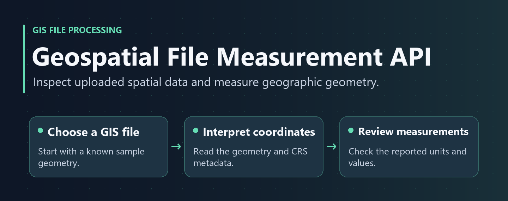

# Geospatial File Measurement API

**Tech stack** · Python · FastAPI · Uvicorn · Shapely · PyProj · PyShp · HTML

Inspect uploaded spatial data and measure geographic geometry.

## What it does

- **Choose a GIS file** · Start with a known sample geometry.
- **Interpret coordinates** · Read the geometry and CRS metadata.
- **Review measurements** · Check the reported units and values.

## Getting started

1. Use the original startup guide in `Arero_QGIS/README.md` for file formats and environment setup.
2. From `Arero_QGIS/server`, install the requirements in a virtual environment with `python -m pip install -r requirements.txt`.
3. From that directory, run `python -m uvicorn app.main:app --reload`, then open `/docs` on the local server.

## Source layout

| Path | Purpose |
| --- | --- |
| `Arero_QGIS/` | Application source and original setup documentation. |
| `Arero_QGIS/server/app/main.py` | FastAPI application entry point. |
| `Arero_QGIS/server/requirements.txt` | Server dependencies. |

## Tests and verification

- Submit a small geometry with a known measurement and check the numeric value and units.
- Repeat with the same geometry expressed in another supported CRS and compare results.
- Send a malformed file and verify that the API returns a useful validation error.

The upstream source has no working automated test suite detected.

## Credits and license

The source audit found no project license. Share changes through a GitHub fork or obtain the owner's redistribution permission.

[Original repository](https://github.com/Pradeep-Polishetty/Geospatial-File-Measurement-API) · `Pradeep-Polishetty` and upstream contributors
